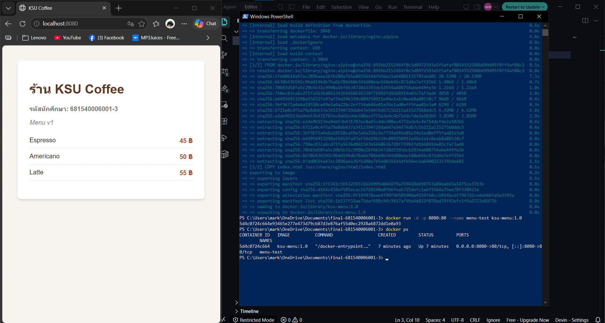
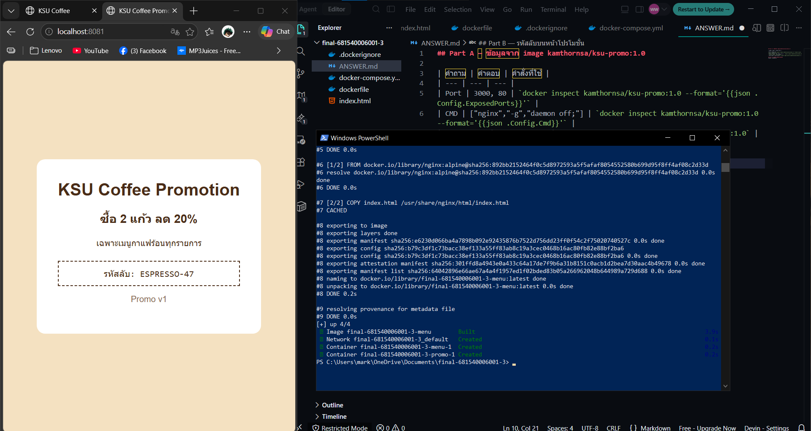
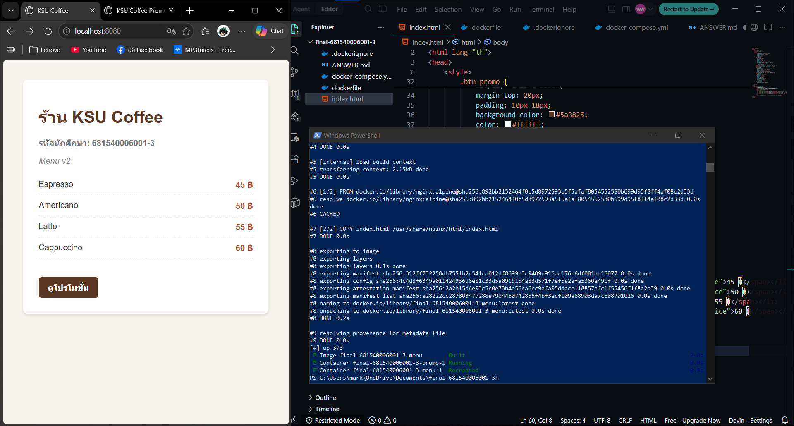

## Part A — ข้อมูลจาก image kamthornsa/ksu-promo:1.0
 
| คำถาม | คำตอบ | คำสั่งที่ใช้ |
| --- | --- | --- |
| Port | 3000, 80 | `docker inspect kamthornsa/ksu-promo:1.0 --format='{{json .Config.ExposedPorts}}'` |
| CMD | ["nginx","-g","daemon off;"] | `docker inspect kamthornsa/ksu-promo:1.0 --format='{{json .Config.Cmd}}'` |
| Base image | nginx:alpine | `docker image history kamthornsa/ksu-promo:1.0` |

## Part B — รหัสลับบนหน้าโปรโมชั่น
รหัสลับ: ESPRESSO-47

## Part C — คำถาม
 
1. หน้าโปรโมชั่นถูก build ฝังอยู่ใน Docker image สำเร็จรูปแล้วและเราไม่มี source code จึงแก้ไขเนื้อหาไม่ได้ ส่วนหน้าเมนูเราถือไฟล์ source code (index.html) ในเครื่อง จึงแก้ไขและ build image ใหม่ได้
2. หากไม่ระบุ tag ตัว Docker จะดึงแท็ก `:latest` มาใช้งานโดยอัตโนมัติ ซึ่งอาจเป็นเวอร์ชันล่าสุดที่มีหน้าตาหรือเนื้อหาไม่ตรงกับเวอร์ชัน `1.0` ที่โจทย์กำหนด
3. ฝั่งซ้าย (8081) คือ Host Port ที่เปิดรับการเชื่อมต่อจากภายนอก ส่วนฝั่งขวา (3000) คือ Container Port ภายใน ซึ่งไม่ใช่ 80 เพราะเว็บเซิร์ฟเวอร์โปรโมชั่นถูกคอนฟิกให้ listen อยู่ที่พอร์ต 3000
4. หน้าเว็บจะไม่เปลี่ยนแปลง เพราะคำสั่ง `docker compose up -d` เพียงอย่างเดียวจะไม่สั่ง build image ใหม่หากมี image เดิมอยู่แล้ว คำสั่งที่ถูกต้องคือ `docker compose up -d --build`
5. ใช้ URL `http://localhost:8081` เพราะการคลิกลิงก์เกิดขึ้นบนเบราว์เซอร์ของเครื่องผู้ใช้ (Host) ซึ่งอยู่นอก Docker network จึงไม่สามารถเข้าถึงผ่านชื่อ service `http://promo:3000` ที่ใช้งานได้เฉพาะระหว่าง container ได้
 
## ภาพหน้าจอ
 

